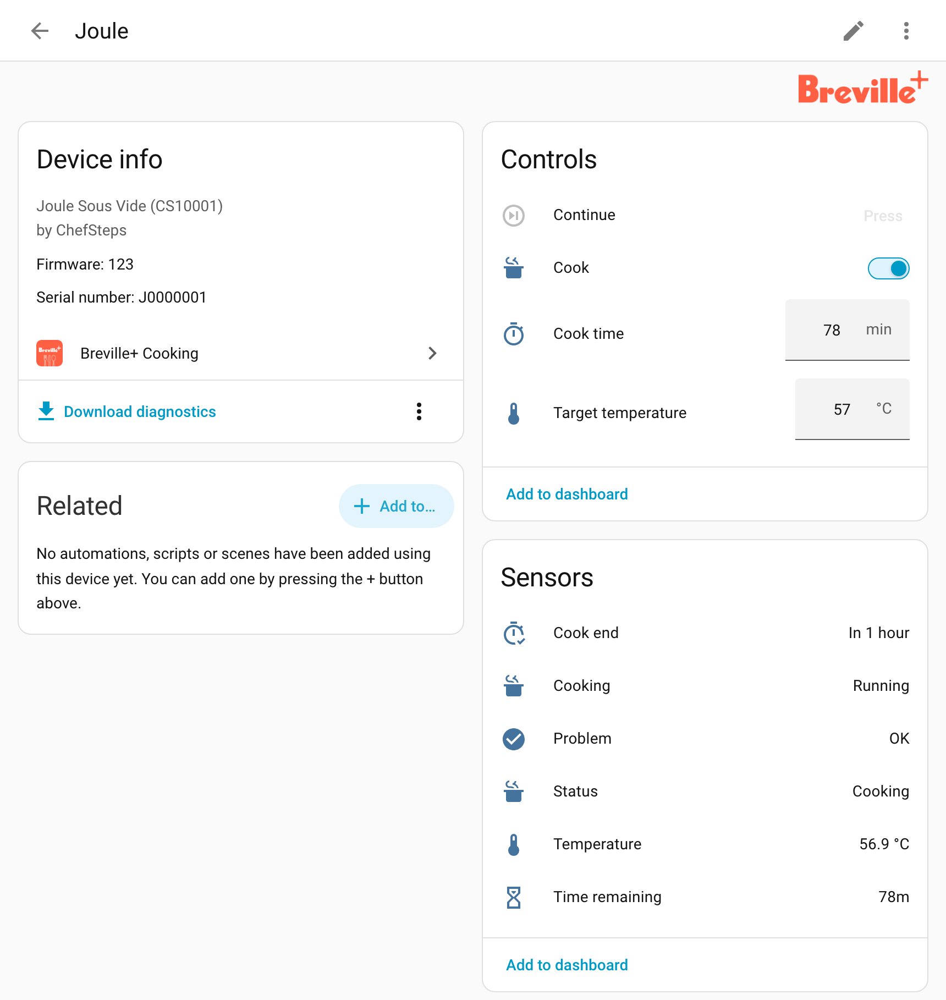

# Breville+ Cooking for Home Assistant

[](https://hacs.xyz/docs/faq/custom_repositories/)
[](https://github.com/kedube/ha-breville-cooking/releases)
[](https://github.com/kedube/ha-breville-cooking/actions/workflows/ci.yml)

[](LICENSE)

<p align="center"></p>

Control your Breville+ Cooking appliances from Home Assistant: start and stop
cooks, change the temperature and timer, and get notified when the water is
ready or the food is done. It uses the same Breville cloud as the Breville+
Cooking app.

This integration is unofficial, and isn't affiliated with or endorsed by
Breville.

[Appliances](#supported-appliances) · [Installation](#installation) ·
[Setup](#setup) · [Entities](#entities) · [Actions](#actions) ·
[Examples](#examples) · [Safety](#safety) ·
[Limitations](#known-limitations) · [Testing](#testing-an-appliance) ·
[Troubleshooting](#troubleshooting) · [Development](#development)

## Supported appliances

| Appliance | Model | Status |
|---|---|---|
| ChefSteps Joule Sous Vide | CSJ100 | Tested on a real appliance |
| Joule Turbo Sous Vide | BSV600 | Built from the app's code; untested |
| Joule Oven Air Fryer Pro | BOV950 | Starting and stopping a bake tried on a real oven; the rest untested |

Untested appliances are monitor-only until you allow control in the
integration's [options](#options). If you have one, please
[help test it](#testing-an-appliance). Sage-branded appliances, sold in the
UK, Europe and the UAE, are supported the same way, but nobody has tried a
Sage account yet.

Other appliances on the account are ignored. For espresso machines, use the
[Sage Coffee](https://github.com/simonjgreen/sageha) integration instead. It's
in the HACS default store; check its README for the models it supports.

## Requirements

- Home Assistant 2026.2 or newer.
- The account you use in the Breville+ Cooking app, or in Sage's version of
  it. Accounts with multi-factor authentication aren't supported.
- The appliance set up in the app and connected to Wi-Fi. A Joule set to
  "Bluetooth only" can't be reached. To use a CSJ100 Joule over Bluetooth,
  see the [ChefSteps Joule Sous Vide](https://github.com/acato/ha-joule)
  integration.

## Installation

### HACS (recommended)

This repository is not in the HACS default store, so add it to HACS as a
custom repository. The quickest way is this button, which opens it in HACS on
your Home Assistant:

[](https://my.home-assistant.io/redirect/hacs_repository/?owner=kedube&repository=ha-breville-cooking&category=integration)

Or add it by hand:

1. In Home Assistant, open **HACS**.
2. Open the menu (**⋮**, top right) and choose **Custom repositories**.
3. Enter `https://github.com/kedube/ha-breville-cooking`, choose the type
   **Integration**, and select **Add**.
4. Search HACS for **Breville+ Cooking**, open it and select **Download**.
5. Restart Home Assistant.
6. [Add the integration](#setup).

### Updating

HACS offers each new release as an update and shows its release notes.
Install the update and restart Home Assistant.

### Manual installation

1. Download `breville_cooking.zip` from the
   [latest release](https://github.com/kedube/ha-breville-cooking/releases/latest).
2. Unzip it into a `breville_cooking` folder inside the `custom_components`
   folder of your Home Assistant configuration directory, creating the folders
   if needed.
3. Restart Home Assistant.

Manual installs don't get update notifications. Repeat these steps to update.

### Removing

1. Go to **Settings → Devices & services → Breville+ Cooking**, then ⋮ →
   **Delete**.
2. In HACS, open **Breville+ Cooking** and choose ⋮ → **Remove**. If you
   installed it manually, delete its `custom_components/breville_cooking`
   folder instead.
3. Restart Home Assistant.

This doesn't change anything on your Breville+ account or appliances.

## Setup

[](https://my.home-assistant.io/redirect/config_flow_start/?domain=breville_cooking)

Or go to **Settings → Devices & services → Add integration** and choose
**Breville+ Cooking**. Log in with your email and password, and choose your
brand: Sage in the UK, Europe and the UAE, and Breville elsewhere. Each
supported appliance on the account becomes a device, named as in the app.

Your password is only sent to Breville. Home Assistant keeps a login session,
not the password, and asks you to log in again if the session expires. To add
another account, add the integration again.

### Options

**Allow control of untested appliances** is off at first. The Joule Turbo and
the Joule Oven haven't been tried on real appliances, so until you turn it on,
Home Assistant only shows their status and can stop a cook, not start or
change one. To turn it on, go to **Settings → Devices & services → Breville+
Cooking → Configure**, and then
[report how it goes](#testing-an-appliance).

## Languages

The integration's screens, entity names and messages follow your Home
Assistant language. They're available in English, German, French, Dutch,
Spanish, Simplified Chinese, Italian, Polish and Swedish. Oven modes use the
Breville+ app's names where those are accurate. If you're a native speaker
and something reads wrong, please edit
`custom_components/breville_cooking/translations/<language>.json` and open a
pull request.

## Entities

Every appliance has:

| Entity | Type | What it does |
|---|---|---|
| Status | Sensor | What the appliance is doing: Idle, Preheating, Ready for food, Cooking, Done, Keeping warm, Press the button on the appliance, Error, Updating or Offline. |
| Temperature | Sensor | The water or oven temperature. |
| Time remaining | Sensor | Time left on the timer. |
| Cook end | Sensor | When the timer will finish. |
| Cooking | Binary sensor | On from the start of a cook to its end, including preheating and waiting for the food. |
| Problem | Binary sensor | On while the appliance reports an error. |
| Error | Sensor (diagnostic) | The error, such as Low water level or Tipped over. |
| Target temperature | Number | The temperature for the next cook, or of the running one. |
| Cook time | Number | The timer in minutes, for the next cook or the running one. For sous vide, 0 holds the temperature until you stop it. |
| Cook | Switch | Turn on to start a cook with these settings, and off to stop it. |
| Continue | Button | Tells the appliance the food is in, which starts the timer, or that it's out. Available only while the appliance is waiting for this. |
| Start timer automatically | Switch (configuration) | Starts the timer as soon as the temperature is reached, instead of waiting for **Continue**. |

The oven also has:

| Entity | Type | What it does |
|---|---|---|
| Mode | Select | Bake, Air fry, Roast, Broil, Pizza and 12 other modes. Choosing one resets the other settings to that mode's defaults. |
| Convection | Select | The fan: Off, On or Super, as the mode allows. |
| Level | Select | Broil intensity (Low, Medium or High) or slow-cook level (Low or High). These modes use it instead of Target temperature. |
| Keep warm | Switch (configuration) | Keeps the food warm when the cook finishes. |
| Door | Binary sensor | Whether the door is open. |
| Active mode | Sensor | The mode of the running cook, including cooks started on the oven. |

Settings for the next cook are kept in Home Assistant, survive restarts, and
go to the appliance only when a cook starts. Changing settings in the
Breville+ app doesn't change them here.
While a cook runs, **Target temperature** and **Cook time** show the running
cook, and changing them changes it. The oven's **Mode**, **Convection** and
**Level** can only be changed while it's idle. Like the app, the integration
keeps to each model's temperature and time limits.

### A sous vide cook, step by step

1. Set **Target temperature** and **Cook time**, then turn on **Cook**.
   Status changes to Preheating.
2. At temperature, Status changes to Ready for food. Put the food in and press
   **Continue** to start the timer. With **Start timer automatically** on, the
   timer starts without waiting for **Continue**.
3. While the food cooks, **Time remaining** counts down and **Cook end** shows
   when it will finish.
4. When the timer ends, Status changes to Done. Take the food out and press
   **Continue**, or turn off **Cook**.

After a remote start, the oven waits for you to press Start on its panel, just
as it does when you start a cook from the Breville+ app. Until then, Status
shows Press the button on the appliance.

## Actions

### Start cook (`breville_cooking.start_cook`)

Starts a cook with the settings you give, without changing the appliance's
entities. Target the appliance's **Cook** switch.

| Field | Description |
|---|---|
| `temperature` | Target temperature, in your Home Assistant unit. |
| `duration` | Cook time, such as `"01:30:00"`. For sous vide, leave it out to hold the temperature until you stop it. |
| `mode` | Oven only: the mode, such as `bake`, `air_fry`, `roast` or `broil`. |
| `convection` | Oven only: `off`, `on` or `super`. |
| `level` | Oven only: `low`, `medium` or `high` for broil modes, and `low` or `high` for slow cook. |
| `auto_start_timer` | Start the timer once the temperature is reached. |
| `keep_warm` | Oven only: keep the food warm when the cook finishes. |

Fields you leave out come from the appliance's entities. If you set `mode`,
they come from that mode's defaults instead, apart from `auto_start_timer` and
`keep_warm`.

```yaml
action: breville_cooking.start_cook
target:
  entity_id: switch.joule_cook
data:
  temperature: 57
  duration: "01:30:00"
```

The standard actions work too. For example, `switch.turn_on` on **Cook**
starts a cook with the entities' settings, `switch.turn_off` stops it, and
`button.press` presses **Continue**.

## Examples

These examples assume an appliance named Joule. Your entity IDs follow the
appliance's name in the Breville+ app.

Get a notification when the water is ready for the food:

```yaml
alias: Joule ready for food
triggers:
  - trigger: state
    entity_id: sensor.joule_status
    to: ready
actions:
  - action: notify.notify
    data:
      message: The water is at temperature. Add the food and press Continue.
```

Get a notification 10 minutes before the cook ends:

```yaml
alias: Joule almost done
triggers:
  - trigger: time
    at:
      entity_id: sensor.joule_cook_end
      offset: "-00:10:00"
actions:
  - action: notify.notify
    data:
      message: Ten minutes to go.
```

Heat the water before you get home, and hold it at temperature:

```yaml
alias: Preheat the Joule
triggers:
  - trigger: time
    at: "17:30:00"
actions:
  - action: breville_cooking.start_cook
    target:
      entity_id: switch.joule_cook
    data:
      temperature: 57
```

## Safety

Cooks start remotely, with nobody nearby. Only start a sous vide when it's in
water, and an oven only when there's nothing inside that shouldn't be heated.
For a delayed start, don't leave raw food sitting in unheated water.
UL-certified Joules (North America) wait for a press of their top button
before cooks above 85 °C, and the Joule Oven waits for a press of Start before
it heats.

## Data updates

Home Assistant keeps one connection open to Breville's cloud, which pushes
changes as they happen, usually within a second or two. If the connection
drops, it reconnects by itself: first after 5 seconds, then less often, up to
5 minutes apart. Entities are unavailable while it's disconnected.

It also checks the account's list of appliances every 30 minutes. New
appliances appear by themselves. Ones that have left the account become
unavailable, and you can then delete them from their device page.

## Known limitations

- The BSV600 and BOV950 haven't been tried on real appliances, so they're
  monitor-only unless you allow control in the [options](#options).
- Nobody has tried a Sage account yet.
- Accounts with multi-factor authentication can't log in.
- The BSV600's Turbo mode isn't offered.
- The oven's Toast, Bagel and Crispy reheat modes can't be started from Home
  Assistant, though **Active mode** shows them.
- The BOV970 and BOV870 ovens aren't supported. The Breville+ app itself has
  no controls for them yet.
- Appliances added to the account can take up to 30 minutes to appear.
- There's no local control. Breville can change its cloud at any time, which
  could break this integration. For Bluetooth control of a CSJ100 Joule, see
  [ChefSteps Joule Sous Vide](https://github.com/acato/ha-joule).

## Testing an appliance

If you have a Joule Turbo, a Joule Oven Air Fryer Pro or a Sage account, you
can help get it supported:

1. Set up the integration, and check that Status, Temperature and the timer
   match the appliance.
2. To try control too, turn on **Allow control of untested appliances** in
   the [options](#options). Stay near the appliance, and only start a sous
   vide when it's in water.
3. Try a short cook. Start it with **Cook**, change **Target temperature**
   and **Cook time**, press **Continue** when asked, then turn **Cook** off.
4. Straight away, download the [diagnostics](#troubleshooting) and attach
   them to an
   [appliance report](https://github.com/kedube/ha-breville-cooking/issues/new?template=appliance_report.yml),
   whether it all worked or not.

## Troubleshooting

- **Entities are unavailable:** Home Assistant can't reach Breville's cloud,
  and keeps trying. If Status shows Offline instead, the appliance itself is
  off or disconnected; check it in the Breville+ app.
- **Asked to log in again:** the Breville session expired. Follow the prompt
  in **Settings → Devices & services** and enter your password.
- **A new appliance is missing:** it appears within 30 minutes. To add it
  straight away, go to **Settings → Devices & services → Breville+ Cooking**,
  then ⋮ → **Reload**.
- **A removed appliance is still listed:** once it's gone from your account,
  open its device page and delete it.
- **Starting a cook says it hasn't been tested:** see [Options](#options).
- **Anything else:** on the same page, choose **Enable debug logging**,
  reproduce the problem, then choose **Disable debug logging** to download the
  log.

When you report a problem or want support for a new model or firmware, attach
the integration's diagnostics: go to **Settings → Devices & services →
Breville+ Cooking**, then ⋮ → **Download diagnostics**. The file contains each
appliance's raw state and its last 50 messages from Breville's cloud, plus
Home Assistant's last 20 requests to the cloud. Your email, name and account
IDs, login tokens, appliance names, serial numbers and network addresses are
removed wherever they appear. Look the file over before posting it publicly.

## Development

```sh
python3 -m pip install -r requirements_test.txt
python3 -m pytest
python3 -m pip install ruff==0.15.17 && python3 -m ruff check .
```

CI runs these, plus Home Assistant's hassfest and the HACS checks, on every
pull request and push to `main`.

### Releasing

Releases are made by hand: on GitHub, open **Actions → Release → Run
workflow** and run it on `main`. After CI passes, the workflow raises the
version in `manifest.json` by 0.01 (0.00 → 0.01, …, 0.99 → 1.00) and commits it
to `main`. It then tags that commit with the bare version (`0.01`, no `v`) and
publishes a GitHub release with generated notes and `breville_cooking.zip`,
which HACS offers as an update. To preview the next version, run
`python3 scripts/bump_version.py`.

### Probe script

`scripts/breville_probe.py` talks to the Breville cloud directly, without Home
Assistant, and logs every request and websocket message (redacted) to
`probe-output/`. It was used to verify the protocol on a Joule. Add
`--brand sage` before the command for a Sage account.

```sh
python3 scripts/breville_probe.py login
python3 scripts/breville_probe.py watch --seconds 600
python3 scripts/breville_probe.py start --temp 55 --minutes 30 --confirm-water
```

The protocol was recovered from the Breville+ Cooking Android app (1.96.0).
[docs/api.md](docs/api.md) documents the cloud API, and marks which parts were
verified on a Joule.

## Trademarks

Breville, Breville+ and their logos are trademarks of Breville. The icon and
logo in `custom_components/breville_cooking/brand/` are from the Breville+
Cooking app, and are used only to identify the appliances this integration
works with. Home Assistant shows them from version 2026.3.
